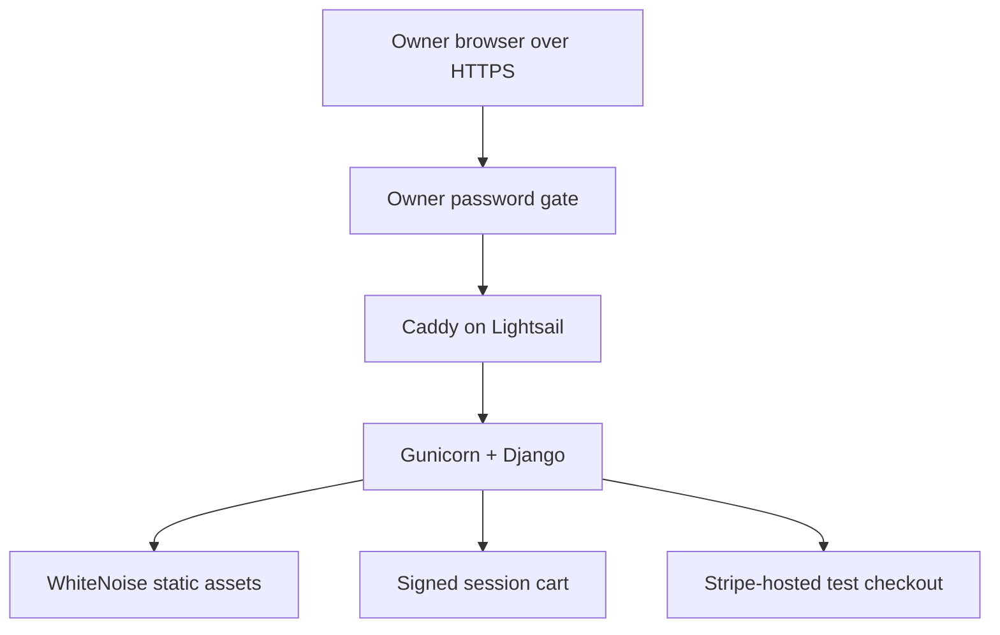

# Proposed AWS deployment — not provisioned

No AWS resources, domain, subscription, or real payment facility was created. The deployed Sites URL is an owner-private interactive preview, not a running Django server. This file describes the separate Python deployment.

## Small-store architecture

For roughly 10–30 monthly visitors, start with a single Linux Lightsail 1 GB instance: $7/month including public IPv4 in the current AWS bundle table. A 2 GB instance is $12/month if more memory is needed. Snapshots, tax, excess usage, an existing DNS provider, and any chosen ancillary services are additional. This traffic does not justify an ALB, NAT Gateway, RDS, or a multi-instance deployment.

Caddy terminates TLS and redirects HTTP. Gunicorn is exposed only inside the Docker network; port 8000 must not be exposed on the instance firewall. Django requires owner authentication on all routes and assets, even if the hostname is guessable. Where practical, restrict HTTPS to the owner's IP or an existing VPN as a second layer. Do not treat an unlisted URL or robots.txt as access control.

An existing authorized DNS hostname is required for the included Caddy configuration. No hostname was purchased or registered. Without one, an existing private VPN with managed HTTPS could be considered separately. Do not expose this app with only HTTP while arranging TLS.

## Runtime and static files

- Build the included Dockerfile with Python 3.12, Django 5.2.18, Gunicorn, and WhiteNoise.
- CSS, JS, favicon, hero, and catalog images live in `shop/static/shop/`.
- Templates use Django's `` tag. App static discovery replaces the previous `templates/assets` / `templates/images` configuration.
- `STATIC_ROOT=staticfiles/` is build output. The Docker build runs `collectstatic` and uses `CompressedManifestStaticFilesStorage`; WhiteNoise serves the result with `DEBUG=False`.
- Keep `SECRET_KEY`, the owner password hash, and any Stripe test key in environment configuration. The `.env.example` contains placeholders only. Set actual values through a private host environment or secrets manager, never in source control or images.
- `TRUST_HTTPS_PROXY=true` is only safe behind the supplied reverse proxy, which sets the forwarded protocol header. Keep the application container port private.
- Cookies use Secure, HttpOnly (session), and SameSite=Lax. CSRF checks stay enabled for cart and checkout mutations. HSTS, allowed hosts, CSP, no-sniff, frame blocking, and no-store headers are configured.

## Data and payment boundaries

Catalog products are immutable JSON placeholders. Cart quantities and prices are validated against that catalog on Django. The cart is stored in a signed, HttpOnly cookie; signed cookies are integrity-protected, not encrypted. No personal data is stored in the cart. SQLite is configured only as Django's default database; the prototype does not require migrations, persistent sessions, or an order database.

The default `CHECKOUT_MODE=simulated` makes no payment API call. `stripe_test` creates a Checkout Session on the server and redirects only to `https://checkout.stripe.com/`. Only test keys are accepted. Completion retrieves the session and checks payment status, test mode, session identity, nonce, and expected amount. A browser return URL alone cannot mark a test checkout as paid.

No real order or stock reservation is created. Before real sales, implement durable orders, database-backed inventory, signed webhook verification, idempotent fulfillment, expiration/reconciliation, tax/shipping rules, and finalized policies. Live credentials and live mode remain deliberately unsupported by this prototype.

## Deployment steps after account/hostname approval

1. Obtain owner-approved access to an existing host or approve the stated Lightsail cost before provisioning anything.
2. Use an existing hostname and valid TLS; restrict access. Supply a random `DJANGO_SECRET_KEY`, explicit allowed host and CSRF origin, and a Django-hashed owner password.
3. On the approved host, run `docker compose --env-file .env -f deploy/compose.yaml up -d --build`. This command is documented, not executed here.
4. Run `python manage.py check --deploy` in the configured image. Verify unauthenticated requests receive 401, invalid hosts fail, HTTP redirects to HTTPS, assets return successfully behind the owner gate, and secure cookies are present.
5. Keep the default simulated mode until an authorized Stripe sandbox key is configured through the host's secret settings. Never paste it into chat.
6. Maintain OS and package updates, bounded log retention, backups if durable data is added, and an AWS budget alert after account access is approved. Do not log auth headers, session cookies, or checkout secrets.

## References checked October 23, 2026

- AWS bundle table: https://docs.aws.amazon.com/lightsail/latest/userguide/amazon-lightsail-bundles.html
- AWS pricing: https://aws.amazon.com/lightsail/pricing/
- Django deployment checklist: https://docs.djangoproject.com/en/5.2/howto/deployment/checklist/
- Django static deployment: https://docs.djangoproject.com/en/5.2/howto/static-files/deployment/
- Stripe Checkout: https://docs.stripe.com/payments/checkout
- Stripe testing: https://docs.stripe.com/testing
